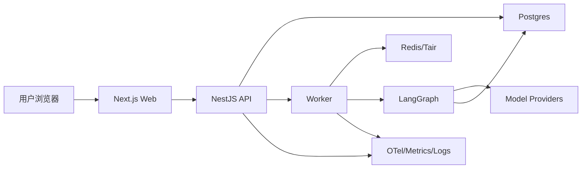

# 系统总体架构

> 本文保留长期目标与技术选型；不能把其中的“建议”“目标仓库结构”当作已上线事实。当前代码、验证命令、云上边界与发布阻断项以 [运行时事实矩阵](./current-runtime-truth.md) 为唯一优先来源。两处冲突时，以事实矩阵为准并修本文。

## 技术选型

| 层 | 选型 | 原因 |
| --- | --- | --- |
| 前端 | Next.js App Router + React + TypeScript | 适合 SEO、应用页、RSC、服务端数据预取。部署不是 Vercel（ADR-0006：不上 Vercel，自管 / 当前仓内 lean compose CD）。 |
| UI | Tailwind CSS + shadcn/ui 或自建轻量组件 | 私人项目先快后稳，后续可沉淀设计系统 |
| API | NestJS + TypeScript | 模块化、依赖注入、契约清晰，便于和 LangGraphJS 共用类型 |
| AI 编排 | LangGraphJS | 状态机、持久化、streaming、interrupt、恢复能力契合模拟面试 |
| 数据库 | Postgres | 支付、权益、状态机、审计和报表更适合关系模型 |
| 向量 | pgvector | 简历片段、岗位画像、题库和推荐可复用 Postgres |
| 缓存 | Redis/Tair | RAG 热缓存、嵌入计算缓存与单飞锁（及默认关闭的 Streams 唤醒原型）；不是耐久任务队列。限流当前落 PG 共享桶表，Redis 限流未接线。云 Redis 真实 E2E 未完成。 |
| 任务队列 | Postgres 表 + `SKIP LOCKED`；唤醒用 `LISTEN/NOTIFY` | 耐久事实在队列表与租约（ADR-0023）。通知不是队列本身。本地接线 ≠ HA / 发布证据。 |
| 对象存储 | S3/MinIO | 简历文件、导出报告、语音文件 |
| 契约 | 共享 zod4 schema；OpenAPI 由 `packages/contracts` 用 zod4 原生 `z.toJSONSchema` 生成（无 `zod-openapi` 包） | 防止前后端接口漂移 |
| 测试 | 隔离 prove + HTTP E2E（fetch/SSE，`pnpm e2e:isolated`）+ 浏览器 Playwright（`e2e:ui:isolated`）+ golden-tasks 登记 | 分层见 `testing/strategy/test-strategy.md`；live E2E 不在 per-push |
| 观测 | OpenTelemetry + Prometheus/Grafana + LangSmith/Langfuse 可选 | trace、成本、graph run、prompt 质量 |

## 目标仓库结构

```text
meetwise/
  apps/
    web/                  # Next.js（组件在 apps/web/components/ui，无 packages/ui）
    api/                  # NestJS + Fastify HTTP API
    worker/               # LangGraph jobs/report/async tasks（唯一 redis 客户端）
  packages/
    ai-graphs/            # LangGraph graphs, states, nodes
    ai-runtime/           # 模型调用关口、Langfuse v5 OTel
    contracts/            # 共享 zod4 schema；OpenAPI 自研生成（无 zod-openapi 包）
    db/                   # 手写 SQL migrations + pg（不是 Prisma/Drizzle）
    db-mysql/             # 本地 MySQL 骨架，未切流
    domain/               # shared domain types；简历解析 mammoth / pdf-parse
    errors/               # 共享错误类型
    qdrant-store/         # Qdrant 原型，非生产切流
    config/               # eslint / prettier / tsconfig
  docker/
    compose.dev.yml
    compose.demo.yml
    compose.observability.yml
  ai-docs/
  .tmp/
```

## 运行时服务



> 依赖实态：api **无** Redis 客户端；Redis/Tair 只在 worker 用于 RAG 热缓存、嵌入计算缓存与单飞锁（及默认关闭的 Streams 唤醒原型），不是任务队列，Redis 限流未接线。对象存储 SDK 未安装；简历原文落 PostgreSQL `resume_blob`，compose 中的 MinIO 是本地基础设施、应用客户端未接线。

## 后端模块

| 模块 | 职责 |
| --- | --- |
| `identity` | 用户、登录、权限、会话 |
| `resume` | 简历文件、解析、版本、结构化画像 |
| `role` | 岗位/JD、岗位画像、技能要求 |
| `assessment` | 能力画像、差距分析、报告 |
| `interview` | 押题、模拟面试、QA、结果 |
| `learning` | 学习计划、训练任务 |
| `commerce` | 订单、权益、消费、退款 |
| `ai-runtime` | graph run、prompt、checkpoint、trace |
| `admin` | 运营后台 |
| `observability` | metrics、audit、cost |

## 核心原则

- Controller 不承载业务编排，只调用 application service。
- AI graph 不直接改支付权益，权益在业务服务中控制。
- Graph state 保存业务运行态，业务事实仍落业务表。
- 所有外部模型调用必须可追踪、可重试、可降级。
- 所有用户内容进入模型前要标记为 untrusted input。
- 所有模型输出进业务前要经过 schema 和业务 validator。

## 数据库建议

现行数据层是手写 SQL migration + `pg`（`packages/db`），**不是** Prisma 或 Drizzle。下面表组名称是领域建议，不以本页冒充已落表名；现行 schema 以 `packages/db/migrations` 为准。

核心表组：

- `users`
- `career_profiles`
- `resumes`
- `resume_versions`
- `role_profiles`
- `interview_results`
- `interview_qas`
- `assessment_reports`
- `entitlements`
- `payment_orders`
- `consumption_records`
- `ai_graph_runs`
- `ai_prompt_versions`
- `ai_invocation_traces`

## API 契约

禁止前端手写不存在的接口。第一阶段就建立：

- `packages/contracts/src/interview.ts`
- `packages/contracts/src/resume.ts`
- `packages/contracts/src/commerce.ts`
- `packages/contracts/src/ai-runtime.ts`

所有接口必须有：

- request schema
- response schema
- error code
- auth requirement
- idempotency rule
- contract test
